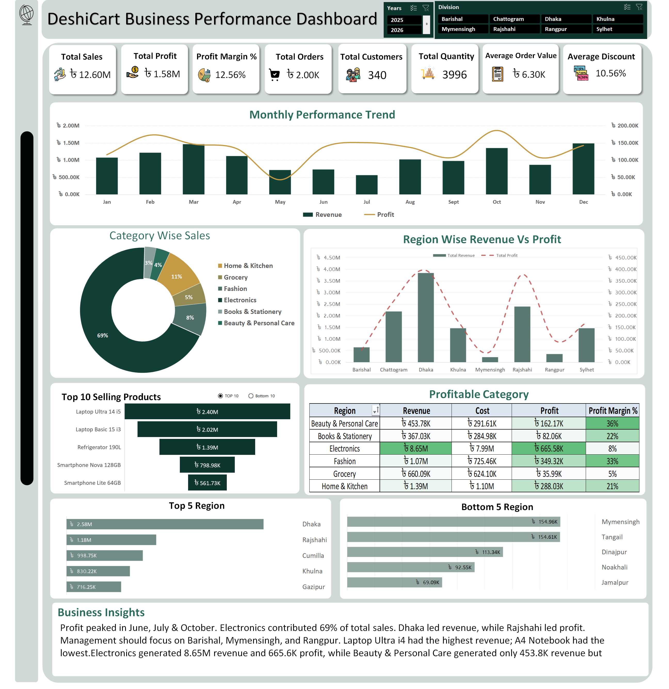
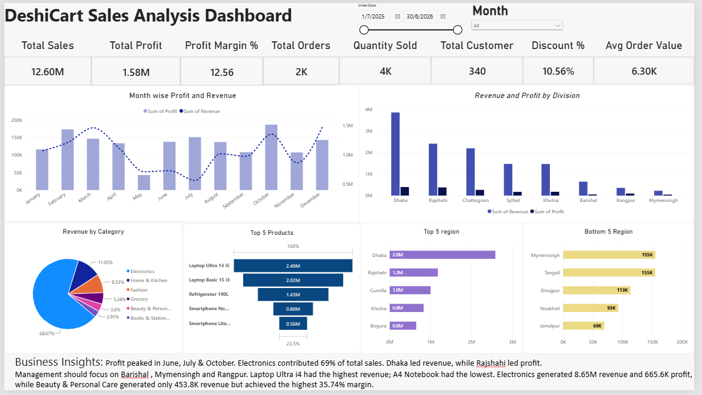
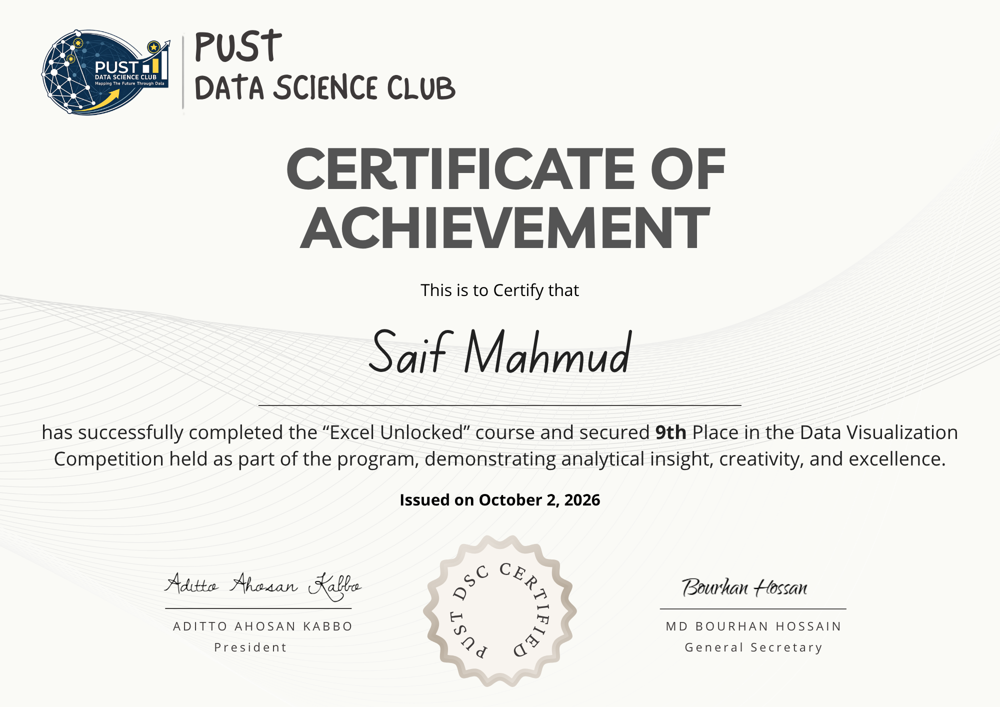
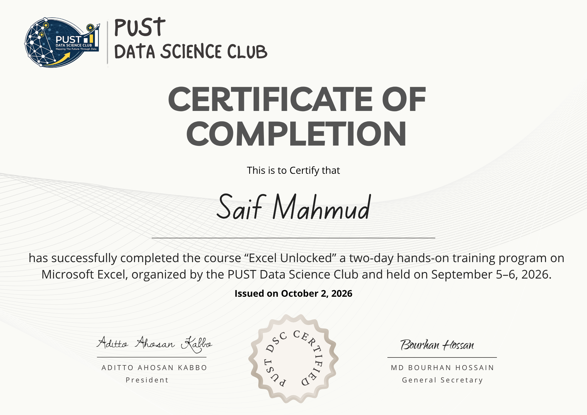

# DeshiCart BD [Sales Performance Dashboard]
An End-to-End Excel Data Analytics Project | ***PUST Data Science Club*** :- Excel Unlocked.

# Project Overview 📌 

This project focuses on analyzing the financial-year sales performance of DeshiCart BD, a fictional online marketplace operating across all eight divisions of Bangladesh.

The objective is to transform raw, uncleaned sales data into a reliable analytical solution using Microsoft Excel. The project follows an end-to-end data analytics workflow, from data cleaning and transformation to KPI development, business analysis, dashboard visualization, and actionable recommendations.

This project is based on the official PUST Data Science Club:- *Excel Dashboard Competition Rulebook*, part of the *Excel Unlocked training* series.

# Business Problem 🎯 

DeshiCart BD has experienced revenue growth, but its profitability remains relatively flat. Management needs a clearer understanding of which products, categories, customers, and regions generate profit and which may be reducing overall business performance.

The dashboard is designed to answer key business questions:

* How does sales performance change month by month?
* Which product categories and products generate the most revenue and profit?
* Which products, subcategories, or trading conditions result in negative profit?
* Which customer segments contribute most to revenue and profitability?
* Which regions are performing well or underperforming?
* How effective are discounts, and at what discount levels does profitability deteriorate?
* What actions should management prioritize to improve business performance?

# Tools & Technologies 🛠️ 
* Microsoft Excel = Data analysis and dashboard development
* Excel formulas = Revenue, cost, profit, KPI calculations, and business metrics
* PivotTables & PivotCharts = Aggregation and performance analysis
* Excel slicers and filters = Interactive dashboard exploration

# Project Workflow 🔄 

The project follows a structured data analytics process:

### Raw Data → Requirments → Data Cleaning → Data Transformation → Business Analysis → KPI Calculation → Dashboard Development → Business Insights

# 1. Data Cleaning & Preparation

The raw dataset is prepared according to the project rulebook.

Key activities include:

 * Removing completely blank rows and duplicate records.
 * Excluding records with zero or negative quantities.
 * Standardizing category, division, subcategory, customer type, and order-status values.
 * Handling missing city and discount values according to the specified rules.
 * Recovering missing customer names and invalid unit costs using matching identifiers.
 * Converting dates and numeric fields into valid Excel data types.
 * Preserving repairable records rather than deleting valid transactions.

# 2. Calculated Fields

The following calculated fields are created for business analysis:

   #### Field              Calculation

    Revenue              Quantity × UnitPrice × (1 − Discount)

     Cost                Quantity × UnitCost

     Profit              Revenue − Cost
     
These calculations provide the foundation for measuring sales performance and profitability.

# 3. Business Analysis

The analysis covers six major areas:

 * Sales Performance: Annual revenue, monthly trends, strongest and weakest months.
 * Profitability: Total profit, profit margin, category profitability, and loss-making products.
 * Product Analysis: Top five products by revenue and profit, plus low-performing subcategories.
 * Customer Analysis: Distinct customers, top 10 customers, revenue contribution, and customer-type performance.
 * Regional Analysis: Revenue and profit by division, top districts, and underperforming locations.
 * Order & Discount Analysis: Order volume, quantity sold, average order value, cancellation rate, sales channels, payment  methods, and discount-band profitability.

# Mandatory KPIs 📈

The dashboard includes the eight KPIs specified in the official competition rulebook.

### KPI                      Definition
 Total Sales                   Sum of Revenue
 Total Profit                  Sum of Profit
 Profit Margin %               Total Profit ÷ Total Sales
 Total Orders                  Number of rows in Clean_Data
 Total Quantity                Sum of Quantity
 Average Order Value           Total Sales ÷ Total Orders
 Average Discount              Average of the Discount column
 Total Customers               Distinct count of CustomerID

*The dashboard's KPI calculations follow the official definitions to maintain consistency with the supporting analysis.*

# Dashboard Features 📊

The dashboard is designed to provide a single-screen overview of business performance.

Planned or implemented visual elements, depending on the final workbook, include:
* KPI cards for essential business metrics.
* Monthly sales performance trends.
* Category and product revenue and profitability comparisons.
* Regional sales and profit analysis.
* Top and bottom performer comparisons.
* Discount-band performance analysis.
* Interactive slicers or filters.
* A dedicated business insights section.

The emphasis is on numerical accuracy, analytical clarity, usability, and professional visual design rather than decoration alone.
 
# Business Insights & Recommendations 💡

The final analysis will document 5–8 numerical, actionable business insights supported by the workbook

# Dashboard Preview 🖼️
   ##  Excel Dashboard

   
   
   ## Power BI (Optional)
   

# Repository Structure

DeshiCart-BD-Sales-Dashboard/
   │
   ├── README.md

   ├── Data/
   │   └── Dashboard_Competition_Saif_Mahmud_Submission_File.xlsx    
   │   └── Dashboard_Competition_Saif_Mahmud.xlsx

   ├── Images/
   │   ├── Excel_Dashboard.png
   │   └── Power_BI_Dashboard.png

   ├── Task/
   │   └── Project_NoteBook.pdf

This is a suggested repository structure. Adjust the folders and filenames to match the files actually included. Share the rulebook, dataset, and completed workbook only where you have permission to do so.

# Key Learning Outcomes 🚀 

This project provides practical experience in:

* Cleaning and standardizing real-world-style sales data.
* Building calculated fields for financial analysis.
* Applying KPI definitions consistently.
* Using PivotTables and PivotCharts to summarize business performance
* Analyzing sales, profitability, customer segments, regions, and discounts.
* Designing an interactive dashboard for business users.
* Translating analytical findings into actionable recommendations.
* Organizing an analytics project for professional portfolio presentation.

# Project Information 👨‍💻

* Project: DeshiCart BD — Excel Dashboard Competition
* Organizer: PUST Data Science Club
* Training Series: Excel Unlocked
* Reporting Period: FY 2025–2026
* Primary Tool: Microsoft Excel
* Additional Tool: Power BI (optional)
* Project Type: Sales Analytics, Data Cleaning, KPI Reporting, and Dashboard Development

# Conclusion 📌

This project demonstrates an end-to-end approach to sales analytics: preparing reliable data, calculating business metrics, identifying performance gaps, and presenting findings through an interactive dashboard.

## 🏆 Competition Result & Lessons Learned

I secured **9th position** in the DeshiCart BD Excel Dashboard Competition organized by PUST Data Science Club.

This experience helped me identify key areas for improvement:

- **Business Insights:** I focused more on creating reports and visuals than developing deeper, data-driven insights and actionable recommendations.
- **Data Cleaning:** I concentrated mainly on building a Power BI dashboard and did not fully address the required data-cleaning workflow and supporting analysis.

These lessons helped me understand that effective data analytics goes beyond visualization—it requires reliable data preparation, meaningful analysis, and actionable business recommendations.

# Certificate

